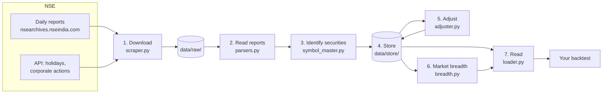
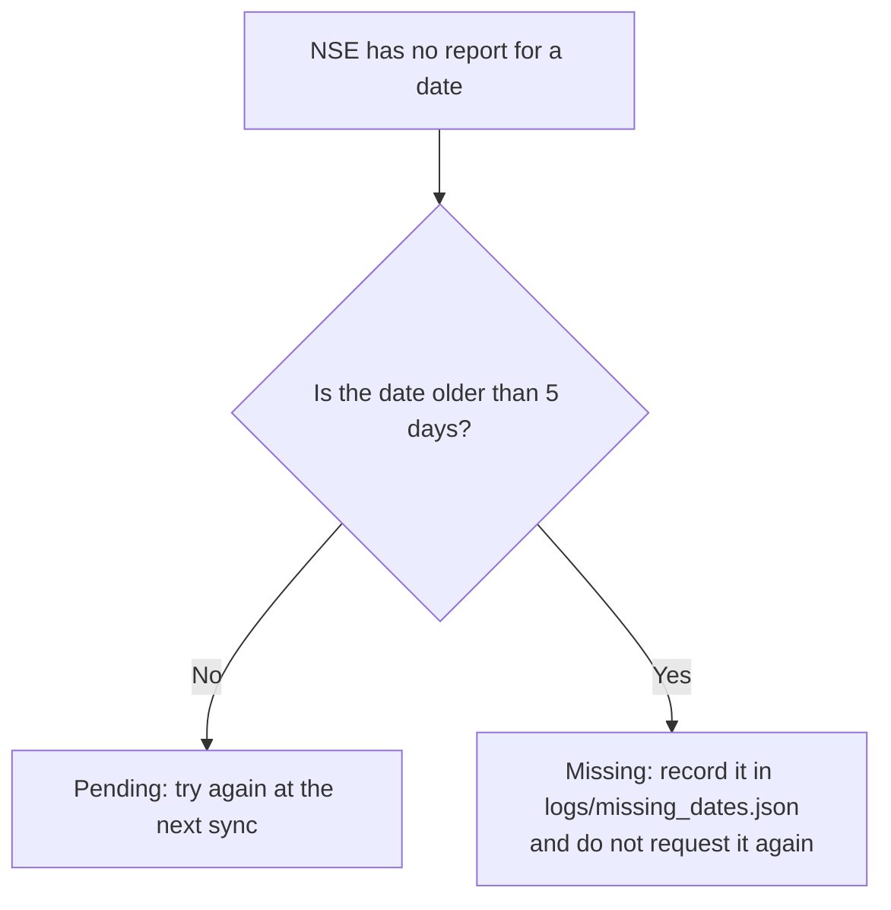
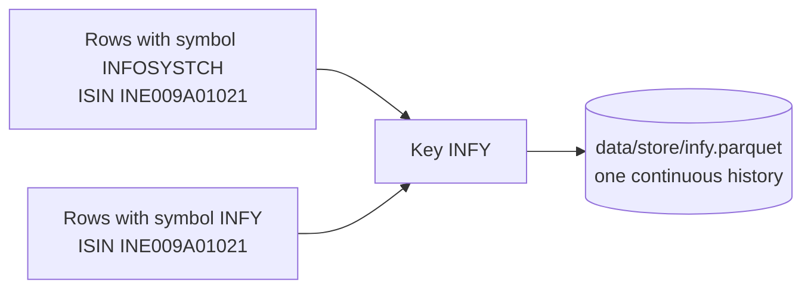
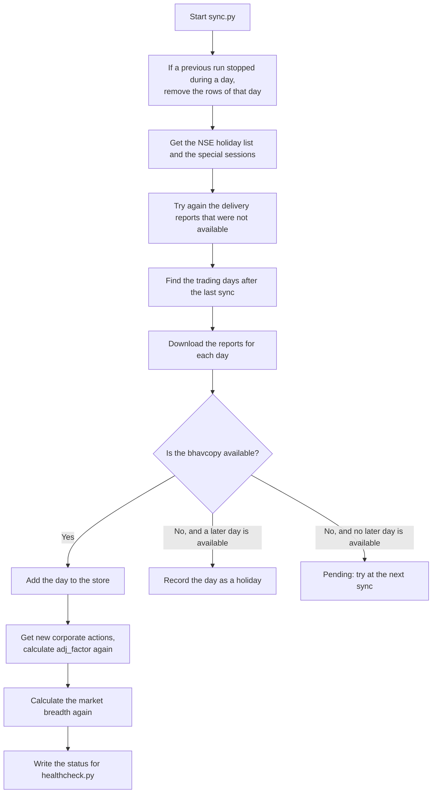
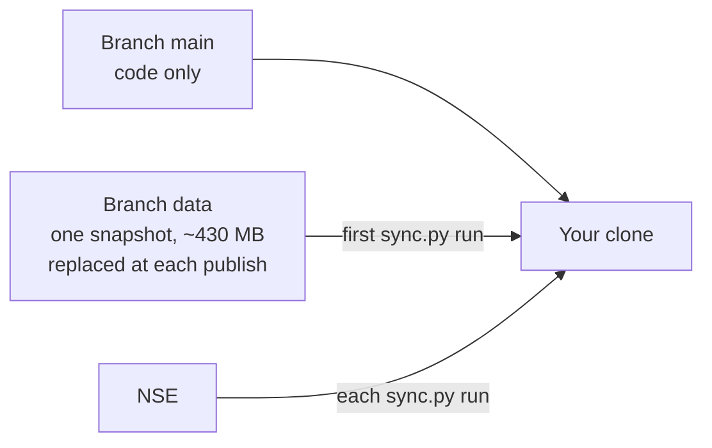

# NSE EOD Database

This project builds and keeps a local database of daily prices for the equities of the National
Stock Exchange of India (NSE). Use the database to test trading strategies on historical data
(backtests).

The database has three important properties:

* **It includes delisted stocks.** A backtest sees the companies that failed, not only the
  companies that survived.
* **It adjusts prices for corporate actions.** A split or a bonus does not show as a false crash.
* **It follows symbol changes.** An old symbol gives the full history of the company.

| Item | Value (snapshot of 2026-10-26) |
|---|---|
| Price history | 2005-01-03 to the last sync |
| Securities | 4,583 (3,975 main board, 608 SME), of which 1,037 are delisted or inactive |
| Index history | 232 NSE indices, from 2012-02-21 |
| Market breadth | 5,407 trading days |
| Storage | One Parquet file for each security, approximately 440 MB in total |

## Contents

1. [Quick start](#1-quick-start)
2. [How the system works](#2-how-the-system-works)
3. [Replicate the database](#3-replicate-the-database)
4. [Use the data](#4-use-the-data)
5. [Operation and troubleshooting](#5-operation-and-troubleshooting)
6. [Tests](#6-tests)
7. [Project layout](#7-project-layout)
8. [Limits](#8-limits)
9. [Credits and license](#9-credits-and-license)

---

## 1. Quick start

Do these steps in PowerShell on Windows. On Linux or macOS, use `.venv/bin/` instead of
`.venv\Scripts\`.

```powershell
git clone https://github.com/ancap97/NSEDATA4ME.git
cd NSEDATA4ME
python -m venv .venv
.venv\Scripts\pip install -r requirements.txt
.venv\Scripts\python sync.py
```

The first `sync.py` run downloads the data snapshot (approximately 430 MB) one time. Then it adds
each trading day after the snapshot date. After the first run, the same command adds only the new
days.

Load the data in Python:

```python
import sys
sys.path.insert(0, r"path\to\this\repo")
from loader import load_wide

px = load_wide("close", start_date="2015-01-01")   # date x symbol, adjusted, incl. delisted
```

---

## 2. How the system works

### 2.1 The big picture

The system has seven stages. Each stage is one Python module.



`sync.py` runs stages 1 to 6. Your code uses stage 7 (`loader.py`) to read the data.

### 2.2 Data sources

All daily data comes from NSE.

| Report | File name | Period | Content |
|---|---|---|---|
| Bhavcopy, old format | `cmDDMONYYYYbhav.csv` | to 2024-07-05 | Open, high, low, close, volume, turnover, trades, ISIN |
| Bhavcopy, UDiFF format | `BhavCopy_NSE_CM_..._F_0000.csv` | from 2024-07-08 | Same data, new format |
| Full bhavcopy | `sec_bhavdata_full_DDMMYYYY.csv` | from 2019 | Delivery quantity and percentage |
| MTO report | `MTO_DDMMYYYY.DAT` | before 2019 | Delivery quantity and percentage |
| Index report | `ind_close_all_DDMMYYYY.csv` | each day | Index OHLC, P/E, P/B, dividend yield |
| PR zip file | `PRDDMMYY.zip` | each day | Announced corporate actions |
| NSE API | — | live | Holidays, corporate actions, special sessions |

NOTE: NSE changed the bhavcopy format on 2024-07-08. The system selects the correct format from
the date.

### 2.3 Stage 1: Download (`scraper.py`)

The scraper downloads each report one time. It keeps each report as a raw file in
`data/raw/<kind>/<year>/` with the NSE file name.

* **Speed limit.** The scraper waits 1.2 seconds (plus a random 0 to 0.6 seconds) between two
  requests.
* **Retries.** Each request has a maximum of 4 attempts. After an HTTP 401 or 403, the scraper
  gets new cookies and tries again.
* **Missing reports.** If NSE has no report for a date, the result depends on the age of the date:



* **No skipped days.** If the bhavcopy download fails because of the network, `sync.py` stops. It
  does not continue with the next day.

### 2.4 Stage 2: Read the reports (`parsers.py`)

The parsers change each report format into one table with the same columns. They apply these
rules:

* Keep only equity series: `EQ`, `BE` and `BZ` (main board), `SM` and `ST` (SME platform).
* Remove rights entitlements (symbols that end in `-RE`).
* Keep one row for each symbol and day. If a symbol has two series, keep the series in this
  sequence: `EQ`, `BE`, `BZ`, `SM`, `ST`.
* Remove rows with a close price of zero or less.
* Add the delivery data from the full bhavcopy or the MTO report. For `BE` and `BZ`
  (trade-for-trade), the delivery is 100 % of the volume.

### 2.5 Stage 3: Identify each security (`symbol_master.py`)

A company can change its symbol. Thus the system identifies a company by its ISIN, not only by its
symbol. Each company has one **key**. The key is the current symbol. An SME company has the suffix
`_SME` (for example `ABC_SME`).

Example: Infosys traded as `INFOSYSTCH` and then as `INFY`. The ISIN stays the same.



The system applies these rules:

* **Symbol change.** If a known ISIN appears with a new symbol, the system renames the key and the
  file. The history stays complete.
* **Face value change.** If a known symbol appears with a new ISIN, the system keeps the same key.
* **Long gap.** If a new ISIN appears after more than 365 days without trades, the system keeps
  one history. It also records the case in `logs/identity_review.csv` for a human check.
* **Before 2011-06-22.** The old bhavcopy has no ISIN. The system joins these rows to the later
  rows by symbol.
* **SME to main board.** If an SME company moves to the main board, `ABC_SME` becomes `ABC`. The
  history stays complete.

The system writes the results to `data/symbol_master.parquet` (one row for each company) and to
`data/isin_symbol_map.json` (all symbol and ISIN periods).

### 2.6 Stage 4: Store the prices (`storage.py`)

* Each security has one Parquet file: `data/store/<key>.parquet`.
* The file contains the **unadjusted** prices from NSE and one more column, `adj_factor`.
* NSE indices have one file for each index name in `data/indices/`. NSE renamed some indices in
  November 2015 (for example `S&P CNX Nifty` → `CNX Nifty` → `Nifty 50`). The loader joins the
  old names and the new name into one history.
* `data/meta.json` keeps the sync state: the last synced date, the holiday list and an
  interrupted day.

### 2.7 Stage 5: Adjust for corporate actions (`adjuster.py`)

A corporate action changes the price of a share without a change in the value of the company.
The adjuster finds these actions and calculates `adj_factor` for each row.

**Sources of corporate actions.** If two sources give the same action, the source with the higher
priority wins:

| Priority | Source |
|---|---|
| 1 | Your corrections in `data/actions/manual_overrides.csv` |
| 2 | NSE corporate-actions API |
| 3 | Initial table from the first build of the database |
| 4 | Reference data from eod2 |
| 5 | PR zip files |
| 6 | Actions found from the price movement |

**Factor for each type of action:**

| Type | Example | Factor |
|---|---|---|
| Split | Face value Rs 10 → Rs 2 | 10 / 2 = 5 |
| Bonus | Bonus 1:1 | 1 + 1/1 = 2 |
| Consolidation | Face value Rs 1 → Rs 10 | 1 / 10 = 0.1 |
| Demerger | Previous close 660.75, ex-date open 400.00 | 660.75 / 400.00 = 1.65 |

For a demerger, NSE finds the open price in a special pre-open session on the ex-date. If a split
or bonus occurs on the same day, the demerger factor does not include it. If the gap is less than
2 %, the system does not apply the demerger. A gap this small is the same as a usual movement.

**Price checks.** The announced data is not always correct. Thus the adjuster compares each
action with the prices:

* If the purpose text is cut off, the adjuster takes the factor from the price movement
  (minimum 15 %).
* If the price drop occurs on a different day, the adjuster moves the ex-date to that day
  (maximum 25 trading days).
* If an announced action leaves no trace in the prices, the adjuster does not apply it. It lists
  the action in `data/actions/unconfirmed_actions.csv`.
* If two sources give one action on two dates (35 days or less) with the same factor, the
  adjuster keeps only one.

**Calculation.** The `adj_factor` of a row is the product of the factors of all actions with an
ex-date after the row date. Adjusted price = price / `adj_factor`. Adjusted quantity =
quantity × `adj_factor`.

Example: a 2-for-1 split with the ex-date on day 3.

| Day | NSE close (unadjusted) | `adj_factor` | Adjusted close |
|---|---:|---:|---:|
| Day 1 | 100.00 | 2 | 50.00 |
| Day 2 | 104.00 | 2 | 52.00 |
| Day 3 (ex-date) | 53.00 | 1 | 53.00 |

On the ex-date, the unadjusted close falls by half. The adjusted close does not fall.

**Verification.** After the calculation, the adjuster compares the adjusted close before and after
each ex-date. If the ratio is less than 0.67 or more than 1.5, it writes a warning to
`data/logs/adjustment_warnings.csv`.

### 2.8 Stage 6: Market breadth (`breadth.py`)

The system calculates the market breadth again after each sync, from the adjusted closes of all
main-board stocks (also delisted stocks). It does not keep a partial state. Thus the breadth always
agrees with the store.

| Column | Meaning |
|---|---|
| `universe` | Number of stocks that traded that day |
| `advances`, `declines`, `unchanged` | Stocks with a higher, lower or equal close |
| `adv_dec_ratio`, `net_adv_ratio` | Advances / declines, and (advances − declines) / total × 100 |
| `ad_line` | Cumulative sum of (advances − declines) / total |
| `pct_above_50dma`, `pct_above_200dma` | Percentage of stocks above the 50-day and 200-day average |
| `new_highs`, `new_lows` | Stocks above the 252-day high or below the 252-day low |
| `net_new_highs`, `net_new_highs_cum` | New highs − new lows, and its cumulative sum |
| `mcclellan_osc` | 19-day average − 39-day average of `net_adv_ratio` |

### 2.9 Stage 7: Read the data (`loader.py`)

The loader is the only part that your code uses. It reads the store, applies `adj_factor`, and
gives the current symbol for each row. When you load many securities, it reads all files in one
fast pass. Section 4 gives the functions.

### 2.10 One sync run from start to end



`sync.py` uses these calendar rules:

* A trading day is a weekday that is not an NSE holiday.
* NSE publishes the reports in the evening. Before 18:00 IST, `sync.py` does not try today.
* A Muhurat session (Diwali Laxmi Pujan) is a trading day, also on a weekend.
* NSE circulars give special Saturday sessions. `sync.py` adds these sessions.
* If the Nifty 50 P/E is 20 or less, or 25 or more, `sync.py` records an alert in
  `data/logs/pe_alerts.csv`.

### 2.11 Crash safety

* Each file write goes to a temporary file first. Then the system renames the temporary file.
  Thus a crash cannot leave a damaged Parquet file.
* Before `sync.py` writes a day, it records the day in `data/meta.json` (`in_progress`). If the
  run stops, the next run removes the rows of that day. Then it adds the day again.
* Before each save, `sync.py` copies `meta.json` to `meta.json.bak`.

---

## 3. Replicate the database

### 3.1 Requirements

| Item | Requirement |
|---|---|
| Operating system | Windows, Linux or macOS |
| Python | 3.11 or later (the tests run on 3.11 and 3.13) |
| Python packages | `requirements.txt`: pandas, pyarrow, numpy, requests, python-dateutil, tqdm |
| Git | Necessary to get the data snapshot automatically |
| Disk space | Approximately 450 MB for the snapshot, plus approximately 1.7 MB of raw reports for each new trading day |
| Network | Access to `nsearchives.nseindia.com` and `www.nseindia.com` |

### 3.2 How the data is distributed



The `main` branch holds only the code. The `data` branch holds one snapshot of the processed data.
The maintainer replaces that snapshot every one or two weeks. `sync.py` starts from the snapshot
and adds all trading days after it. Thus your copy is current, also when the snapshot is old.

### 3.3 Make a copy

1. Do the steps in [Quick start](#1-quick-start).
2. Wait until `sync.py` stops. Each missing day takes approximately one minute.
3. If you downloaded the repository as a zip file (not with `git clone`), do these steps:
   1. Download <https://github.com/ancap97/NSEDATA4ME/archive/refs/heads/data.zip>.
   2. Extract the zip file.
   3. Move the `data` folder from `NSEDATA4ME-data\` into the repository folder.
   4. Make sure that the folder `NSEDATA4ME\data\store\` exists.
   5. Run `sync.py`.

### 3.4 Make sure that the copy is correct

1. Run the health check:

   ```powershell
   .venv\Scripts\python healthcheck.py
   ```

2. Read the result. If the exit code is 0, the status is `HEALTHY`.
3. If the exit code is 1, read the lines that start with `PROBLEM`. Then go to
   [Troubleshooting](#55-troubleshooting).
4. Optional: run the tests (see [Tests](#6-tests)).

### 3.5 Keep the copy current

Run `sync.py` each trading day after 18:00 IST. You can use a scheduled task.

Windows Task Scheduler (19:00 IST, Monday to Friday). Type this command in Command Prompt
(`cmd.exe`), not in PowerShell:

```bat
schtasks /Create /SC WEEKLY /D MON,TUE,WED,THU,FRI /ST 19:00 /TN "NSE EOD Sync" ^
  /TR "\"C:\path\to\.venv\Scripts\python.exe\" \"C:\path\to\sync.py\""
```

Linux or macOS (cron):

```
0 19 * * 1-5  cd /path/to/project && .venv/bin/python sync.py
```

### 3.6 Publish your own snapshot (maintainers)

1. Make sure that no sync is in progress.
2. Build the snapshot and push it:

   ```powershell
   .venv\Scripts\python publish_data.py --push
   ```

`publish_data.py` writes a new commit without a parent on the `data` branch. It excludes
`data/raw/` and `data/logs/`. Then it force-pushes the branch. The new snapshot replaces the old
snapshot. Thus the repository size stays at approximately one snapshot.

CAUTION: Do not sync on two computers between two snapshots. Git cannot merge the Parquet files of
two computers. To use a second computer, get the latest snapshot before you sync. Then publish a
new snapshot after you sync.

### 3.7 What you cannot replicate

No tool can build the database again from the first day. The tool for a full build was removed.
The `data` branch snapshot is the starting point.

CAUTION: If your local copy is important, keep a backup of the `data/` folder.

---

## 4. Use the data

### 4.1 Load data in Python

```python
import sys
sys.path.insert(0, r"path\to\this\repo")

from loader import load_data, load_wide, load_symbol, load_index, load_breadth, load_actions, list_symbols, list_indices

px   = load_wide("close", start_date="2015-01-01")          # date x symbol, adjusted, incl. delisted
vol  = load_wide("volume", start_date="2015-01-01")
df   = load_data(["RELIANCE", "TCS"], start_date="2010-01-01")   # long format
rel  = load_symbol("RELIANCE")                               # one security, date index
raw  = load_data(["ITC"], adjusted=False)                    # NSE prices as published
nifty = load_index("Nifty 50")                               # OHLC + P/E, P/B, div yield
acts = load_actions("IRCTC", adjusting_only=True)
```

To add the repository to the Python path permanently, put a `.pth` file in your other virtual
environment:

```powershell
"path\to\this\repo" | Out-File -Encoding ascii .venv\Lib\site-packages\nse.pth
```

NOTE: To read the data, you need only `pandas`, `pyarrow` and `numpy`.

### 4.2 Functions

| Function | Result |
|---|---|
| `load_data(symbols=None, start_date="2005-01-01", end_date=None, include_delisted=True, include_sme=False, adjusted=True, columns=None)` | One row for each security and day |
| `load_wide(field="close", adjusted=True, **kw)` | Table with dates as rows and symbols as columns |
| `load_symbol(symbol, adjusted=True, **kw)` | One security, with the date as index |
| `load_index(name="Nifty 50", start_date=None, end_date=None)` | One NSE index |
| `load_breadth(start_date=None, end_date=None)` | Market breadth (see 2.8) |
| `load_actions(symbol=None, adjusting_only=False)` | Corporate actions |
| `list_symbols(include_delisted=True, include_sme=False)` | The symbol master: key, symbol, ISIN, status, dates |
| `list_indices()` | Index names |

### 4.3 Columns

| Column | Meaning |
|---|---|
| `date` | Trading day |
| `symbol` | Current symbol of the company |
| `key` | Storage key (current symbol, `_SME` for SME companies) |
| `isin` | ISIN on that day (empty before 2011-06-22) |
| `series` | NSE series (`EQ`, `BE`, `BZ`, `SM`, `ST`) |
| `open`, `high`, `low`, `close` | Prices (adjusted if `adjusted=True`) |
| `prev_close` | NSE reference price of the previous day |
| `volume` | Shares traded (adjusted if `adjusted=True`) |
| `turnover` | Value traded in rupees (not adjusted) |
| `trades` | Number of trades (from 2011-06-22) |
| `deliv_qty`, `deliv_pct` | Delivered shares and percentage of volume |
| `adj_factor` | Factor that the loader uses for the adjustment |

### 4.4 Rules for correct backtests

* For returns, use `close.shift(1)`. Do not use `prev_close`.
* To include delisted stocks, keep `include_delisted=True` (the default).
* Dividends and rights issues are not in the adjustment. Total-return backtests need your own
  dividend data.
* An old symbol gives the full history (`load_symbol("INFOSYSTCH")`). If one call has an old
  symbol and the current symbol of one company, the loader gives the company one time.
* If you load all symbols, the loader reads approximately 4,500 files. To make this faster, set
  `start_date` and `columns`. Keep the result in your project (for example `px.to_parquet(...)`).

---

## 5. Operation and troubleshooting

### 5.1 Commands

```powershell
.venv\Scripts\python sync.py                          # after 18:00 IST; fetches every day since last sync
.venv\Scripts\python sync.py --force                  # try today before 18:00
.venv\Scripts\python sync.py --redo-date 2026-09-04   # re-download + re-ingest one day
.venv\Scripts\python healthcheck.py                   # status; exit 1 = needs attention
.venv\Scripts\python healthcheck.py --json            # status for scripts
.venv\Scripts\python publish_data.py --push           # refresh the data branch (maintainer)
```

### 5.2 Health check

`healthcheck.py` gives exit code 1 if one of these conditions is true:

* The data is more than 3 trading days behind.
* The last sync failed, or a sync stopped during a day.
* The store, the breadth and `meta.json` do not agree on the last date.
* An index report could not be read.
* There are adjustment warnings.

Other information (for example identity cases to check) shows as `note` lines. Notes do not change
the exit code.

### 5.3 Correct a corporate action

1. Open `data/actions/manual_overrides.csv`. (Git tracks this file on `main`.)
2. Add one row with these columns: `symbol`, `ex_date`, `type`, `factor`, `action`, `note`.
3. Set `type` to `SPLIT`, `BONUS`, `CONSOLIDATION` or `DEMERGER`.
4. Set `factor` to the price before the action divided by the price after the action.
5. Set `action` to `add` (apply this action) or `ignore` (do not apply this action).
6. Run `sync.py`.

### 5.4 Worker processes

For a large batch, `sync.py` writes the security files in a few worker processes (by default, a
maximum of 4).
Examples are the ~3,400 files of one day and a `--redo-date` run. To use only one process, set
this variable before you run `sync.py`:

```powershell
$env:NSE_SYNC_WORKERS = 1
```

### 5.5 Troubleshooting

| Symptom | Cause | Action |
|---|---|---|
| `sync.py` stops with a network error | NSE did not answer | Run `sync.py` again later. It continues from the last good day. |
| HTTP 403 from NSE | NSE blocks too many requests | Wait some hours. Then run `sync.py` again. |
| `N trading days behind` | No sync for some days | Run `sync.py` after 18:00 IST. |
| `a sync was interrupted` | A run stopped during a day | Run `sync.py`. It removes the partial day first. |
| `adjustment warning(s)` | An applied factor does not agree with the prices | Read `data/logs/adjustment_warnings.csv`. Add a row to `manual_overrides.csv` (5.3). |
| `meta.json is not valid JSON` | The file is damaged | Copy `data/meta.json.bak` to `data/meta.json`. |
| `index report could not be parsed` | NSE changed the report format | Correct `parse_indices` in `parsers.py`. Then run `sync.py --redo-date <date>`. |
| `No data/ folder and no git remote` | The repository came from a zip file | Do the zip steps in 3.3. |

---

## 6. Tests

```powershell
.venv\Scripts\pip install pytest
.venv\Scripts\python -m pytest -q            # offline: fixtures + a small synthetic database, ~2 min
```

The tests do not use `data/` or the network. They send each data path to a temporary folder, and
they stop all HTTP requests. The tests use:

* Sample files in the real NSE formats (old bhavcopy, UDiFF bhavcopy, delivery, MTO, index, PR).
* A small artificial market with a split, a bonus, a symbol change, a delisting, an SME company
  and a renamed index.
* A simulated NSE server for the full `sync.py` run.

GitHub Actions runs the tests and the core `ruff` rules on Ubuntu and Windows. This occurs for each
pull request and for each push to `main`.

---

## 7. Project layout

```
NSEDATA4ME/
├── loader.py          read API (import this file)
├── sync.py            update command
├── healthcheck.py     status check
├── bootstrap.py       gets the snapshot on the first run
├── publish_data.py    publishes the data branch (maintainer)
├── config.py          paths and settings
├── scraper.py         stage 1: download
├── parsers.py         stage 2: read the reports
├── symbol_master.py   stage 3: identify each security
├── storage.py         stage 4: Parquet files and meta.json
├── adjuster.py        stage 5: corporate actions and adj_factor
├── breadth.py         stage 6: market breadth
├── pipeline.py        joins stages 2 to 4 for each day
├── tests/             offline tests
├── docs/REVIEW.md     code review notes
└── data/
    ├── store/         one Parquet file for each security (unadjusted + adj_factor)
    ├── indices/       NSE indices
    ├── breadth/       market breadth
    ├── actions/       corporate actions and manual_overrides.csv
    ├── raw/           downloaded NSE reports (not published)
    ├── logs/          sync log, warnings and status (not published)
    ├── symbol_master.parquet, isin_symbol_map.json, symbol_state.json
    └── meta.json      sync state
```

On `main`, Git tracks only `data/actions/manual_overrides.csv`. The other processed data comes from
the `data` branch. The folders `data/raw/` and `data/logs/` stay on your computer.

---

## 8. Limits

* Dividends and rights issues are not in the adjustment.
* A demerger with a price gap of less than 2 % is not applied. Add it in `manual_overrides.csv`.
* Index history starts on 2012-02-21. Trade counts start on 2011-06-22.
* No tool can build the database again from the first day. The `data` snapshot is the starting
  point.
* NSE can block automated requests for some time. If this occurs, wait and run `sync.py` again.

---

## 9. Credits and license

This is an independent project. These people and projects gave inspiration for it:

* **Benny Thadikaran** and his project [eod2](https://github.com/BennyThadikaran/eod2). The initial
  bulk set of PR files (historical corporate actions) came from him. Some small parts of the code
  are adapted from his projects:
  * the rules that read the purpose text of corporate actions (`adjuster.py`)
  * the NSE request headers and cookie handling (`scraper.py`)
  * parts of the rules that identify a company across symbol changes (`symbol_master.py`)
* **Portfolio Yoga** and its data stack.

Some parts of the code come from projects with the GNU General Public License v3.0. Thus this
project also has the **GNU General Public License v3.0**. See [LICENSE](LICENSE).

NSE publishes the market data. The data stays subject to
[NSE's terms of use](https://www.nseindia.com/static/nse-terms-of-use).
